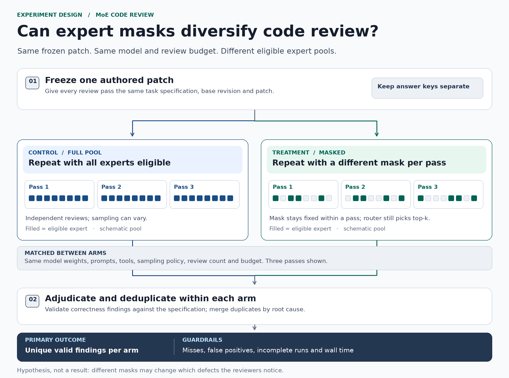

# MoE expert masking for code review

LLM judges [can give higher scores to answers that look more familiar to them](https://arxiv.org/abs/2410.21819). That’s one reason I’d rather have a different model family review a patch. But what if I only have one model to work with? Could I nudge its output distribution without hurting its reasoning?

MoE models give us something to try. [Cerebras’s REAP](https://www.cerebras.ai/blog/reap) shows that pruning carefully chosen experts can preserve much of a model’s performance. So maybe I can mask out a different set of experts on each review pass and get the same model to notice different bugs. That’s the idea, anyway. REAP doesn’t tell us whether random masks will help a reviewer or just make it worse.

Here’s a little experiment to find out.



[Editable Excalidraw diagram](docs/expert-masking-experiment.excalidraw)

## Components

- `vendor/strata`: a pinned submodule of my [Strata research branch](https://github.com/SoloveyLS/Strata/tree/2bd83ef6ca30cfaf9a19225c05fc86207cdaa4b8). It adds opt-in expert masks and sparse expert loading to [upstream 87dfca0e](https://github.com/Niko1221/Strata/commit/87dfca0e7c3ee24ad36cc3f69a31b859587245f8). The fork keeps the upstream MIT notice.
- `download_benchmark.py`: fetches one pinned public fmt source snapshot for an ordinary output-alignment case. I’ve included this one example, not the original multi-repo corpus. The download contains no task patches, issue text, grading data or model weights.
- `test_downloader.py`: checks arguments, Git commands and validation without touching the network.

## Quick start

You’ll need Git, uv and Python 3.10+. The CPU demo also needs a C++17 compiler with pthread support. Set `CXX` if you need to pick a compiler. There are no third-party Python dependencies.

```sh
git clone --recurse-submodules https://github.com/SoloveyLS/moe-expert-masked-review.git
cd moe-expert-masked-review
uv run --frozen --offline python demo.py
uv run --frozen --offline python -m unittest -v
```

Cloned without submodules? Run `git submodule update --init --recursive` first. The demo checks that Strata is at the pinned commit with no local changes, prints the fixture’s source and revision, and runs the CPU expert-mapping test in a temporary directory. It doesn’t download the fixture, start Strata inference or ask a model to review anything.

To see where the example came from or download its source:

```sh
uv run --frozen --offline python download_benchmark.py --show
uv run --frozen --offline python download_benchmark.py --out ./fmt-alignment-base.tar
```

`--offline` keeps uv from fetching dependencies. The download command still uses Git to fetch the fixed fmt commit into a temporary directory. It writes the tar at the path you choose, refuses to overwrite it, and doesn’t extract, build or run anything. The source keeps its upstream license.

## What I’d compare

Why not compare several masked passes to a single unmasked one? Extra attempts alone might find more bugs. I’d give both groups the same number of independent passes.

- Start with a patch in code you own or a vetted example of an ordinary correctness bug, like output alignment. Freeze the patch and keep the answer key separate.
- Give both groups the same patch, spec, prompt, token budget and sampling settings. Let the control use the full expert pool on every pass. Pick the masks ahead of time and keep each mask fixed for its entire pass.
- Check findings by hand against the spec and observed behavior. Count bugs by root cause so the same finding doesn’t count twice. Report distinct correct findings, misses and false positives for each group.
- Record completion, wall time and throughput separately. A timeout or missing result doesn’t count as a clean review. Keep author and grader inputs and raw review traces private.

Masking narrows the pool the router can pick from. It doesn’t, by itself, lower the number of experts routed per token.

## What’s tested so far

The CPU test checks identity mode, expert mapping, sparse reads, padding, short reads, concurrent reads and duplicate rejection. I haven’t validated the GPU build or run an end-to-end model review for this release, so there’s no result yet on whether masking improves reviews.

The Strata changes are experimental and aren’t supported upstream. This repo gives you the experiment design, a CPU demo and the example downloader. It doesn’t include a batch reviewer or an automated vulnerability workflow.
